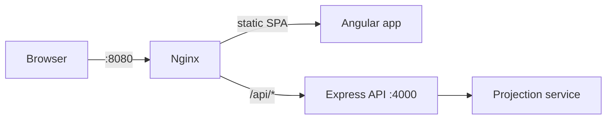

# Retirement Planner — Full-Stack Demo

A small, end-to-end demo built in the **Node.js + Angular + TypeScript** stack that takes a
financial-planning feature from concept to deployment: project your retirement savings growth,
see your sustainable retirement income (the "4% rule"), and check whether you're on track for a
target income.

> **Note:** This is a **demonstration project**, not production software. It exists to show
> engineering practices — clean REST design, automated tests, Docker, and CI — in the stack used
> by Fidelity's digital-presence teams (Node, Angular, REST).

## Tech stack

| Layer | Technology |
|---|---|
| Frontend | Angular 22 (standalone), TypeScript, RxJS, reactive forms, signals, SCSS |
| Backend | Node.js, Express, TypeScript |
| API | REST (`POST /api/projections`), JSON |
| Testing | Vitest (backend unit), Playwright (E2E) |
| DevOps | Docker, Docker Compose, GitHub Actions CI |

## Architecture



Full architecture document (system context, containers, request flow, API contract, deployment):
**[docs/architecture.md](docs/architecture.md)** · decisions: **[docs/adr/0001-stack-and-architecture.md](docs/adr/0001-stack-and-architecture.md)**

## Project docs

| Doc | Purpose |
|---|---|
| [docs/architecture.md](docs/architecture.md) | System shape, containers, request flow, API contract, deployment |
| [docs/adr/](docs/adr/) | Decision log — why we chose what we chose |
| [docs/ROADMAP.md](docs/ROADMAP.md) | Now / Next / Later |
| [docs/PHASES.md](docs/PHASES.md) | Work breakdown + status |
| [AGENTS.md](AGENTS.md) | Instructions for AI coding agents |
| [docs/ai-assisted-development.md](docs/ai-assisted-development.md) | How we work with AI + review gates |
| [docs/style-guide.md](docs/style-guide.md) | Prose conventions |
| [CONTRIBUTING.md](CONTRIBUTING.md) | How to contribute + document changes |
| [CHANGELOG.md](CHANGELOG.md) | Release history |

## Project structure

```
retirement-planner/
├── server/            # Node.js + Express + TypeScript REST API
│   ├── src/
│   │   ├── app.ts             # Express app + middleware + routing
│   │   ├── index.ts           # entrypoint
│   │   ├── routes/            # HTTP layer
│   │   ├── services/          # domain logic (projection math)
│   │   └── types.ts           # shared contracts
│   └── test/                  # Vitest unit tests
├── client/            # Angular 22 SPA
│   └── src/app/
│       ├── features/planner/  # the planner screen
│       ├── services/          # HttpClient API client
│       └── models/            # typed contracts
├── e2e/               # Playwright smoke test
├── docker-compose.yml
└── .github/workflows/ci.yml
```

## Run locally

```bash
# Terminal 1 — API
cd server
npm install
npm run dev          # http://localhost:4000

# Terminal 2 — UI (proxies /api to :4000)
cd client
npm install
npm start            # http://localhost:4200
```

## Run with Docker

```bash
docker compose up --build
# UI  → http://localhost:8080
# API → http://localhost:4000
```

## API

`POST /api/projections`

```json
{
  "currentAge": 30,
  "retirementAge": 65,
  "currentSavings": 50000,
  "monthlyContribution": 500,
  "annualReturnPct": 7,
  "desiredAnnualIncome": 40000
}
```

Returns year-by-year balances plus the final balance, total contributions/growth, the
sustainable annual income (4% withdrawal), and a shortfall/on-track verdict against the
desired income. Invalid input returns `400` with an `error` message.

`GET /api/health` — liveness check.

## Testing

```bash
# Backend unit tests (Vitest)
cd server && npm test

# E2E (Playwright) — against a running app (Docker :8080 by default)
cd e2e
npm install
npx playwright install chromium
BASE_URL=http://localhost:8080 npm test
```

## CI

`.github/workflows/ci.yml` runs on push/PR:

- **backend** — `npm ci`, `npm test`, `npm run build`
- **frontend** — `npm ci`, `npm run build`
