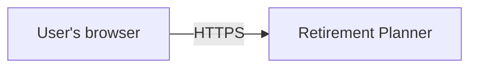
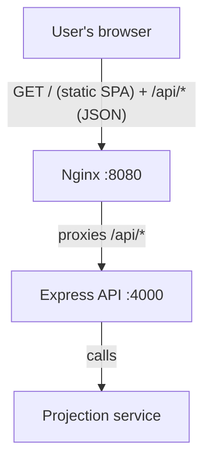
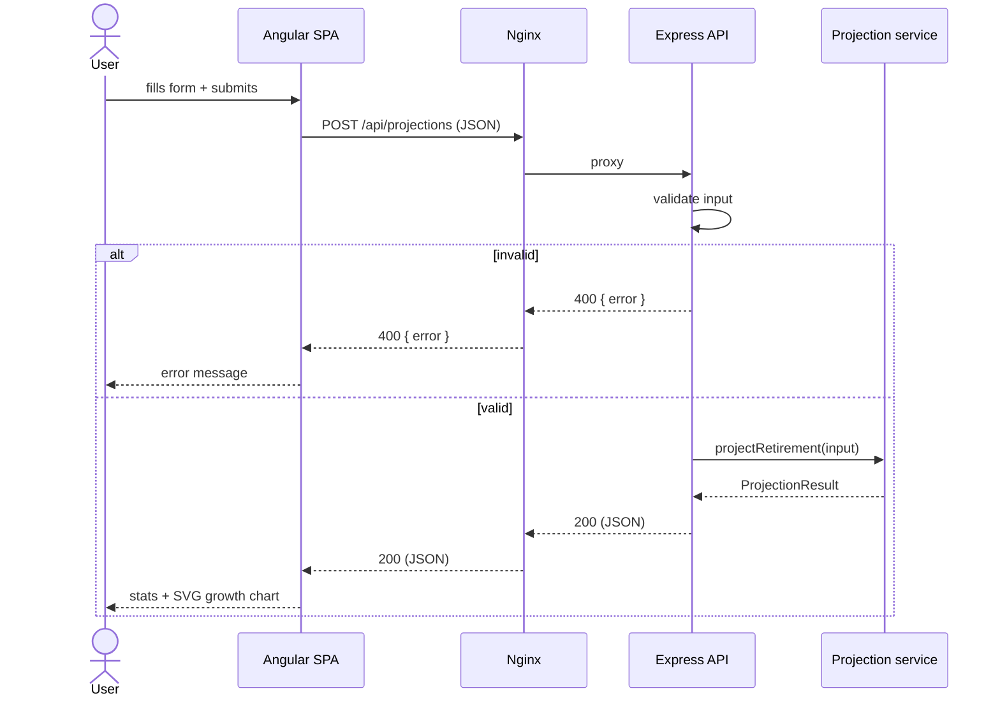
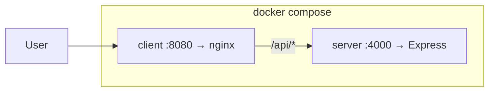
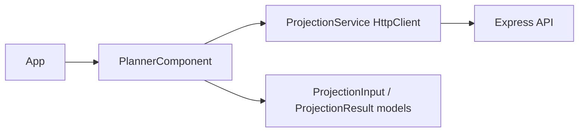

# Architecture

> C4-lite view of the Retirement Planner demo. Decisions ("why") live in
> [`docs/adr/0001-stack-and-architecture.md`](adr/0001-stack-and-architecture.md).

## 1. System Context (C4 Level 1)



A single self-contained system with no external dependencies: no database, no third-party APIs.
A user opens the SPA, enters retirement assumptions, and views a projection.

## 2. Containers (C4 Level 2)



| Container | Technology | Responsibility |
|---|---|---|
| Nginx | nginx:1.27-alpine | Serves the Angular bundle; reverse-proxies `/api/*` to the API (removes CORS in deployed mode). |
| Express API | Node.js + Express + TypeScript | HTTP layer: validation, routing, JSON responses. |
| Projection service | TypeScript (module) | Pure domain logic: compounding math, 4% rule, shortfall. No framework dependencies — unit-testable in isolation. |

## 3. Request flow



## 4. API contract

`POST /api/projections` — request:

```json
{
  "currentAge": 30,
  "retirementAge": 65,
  "currentSavings": 50000,
  "monthlyContribution": 500,
  "annualReturnPct": 7,
  "desiredAnnualIncome": 40000
}
```

Response (type `ProjectionResult`, shared shape on both sides of the boundary):

```json
{
  "years": [{ "year": 1, "age": 31, "balance": 59920.0 }],
  "finalBalance": 1421309.83,
  "totalContributions": 260000,
  "totalGrowth": 1161309.83,
  "sustainableAnnualIncome": 56852.39,
  "desiredAnnualIncome": 40000,
  "shortfall": 0,
  "onTrack": true
}
```

The same contract is expressed as TypeScript interfaces in `server/src/types.ts` and
`client/src/app/models/projection.model.ts` — a single source of truth duplicated deliberately
at the boundary (a codegen/shared-package step is a noted follow-up, not needed at this scale).

`GET /api/health` — liveness check → `{ "status": "ok", "service": "retirement-planner-api", "time": "…" }`.

**Omni-channel / mobile readiness:** the API is client-agnostic — plain REST + JSON with no
web-specific coupling (no server-rendered HTML, no required cookies or sessions). A native
iOS/Android client (e.g., Fidelity Mobile) consumes the same `/api/projections` contract as the
Angular SPA, which is the point of the "omni-channel" requirement this demo supports.

## 5. Deployment



- **Local dev:** `server` runs via `tsx watch` (:4000); `client` runs via `ng serve` (:4200) with
  Angular's dev-server proxy forwarding `/api` to :4000.
- **Containerized:** `docker compose up --build` — nginx serves the built SPA and proxies `/api` to
  the Express container.

## 6. Component structure (C4 Level 3, client)



- `PlannerComponent` — reactive form (inputs/validation), signals for `result`/`error`/`loading`,
  computed SVG chart points.
- `ProjectionService` — thin typed wrapper over `HttpClient`.

## Non-goals

Auth, persistence, real market data, inflation modeling, and production observability are
deliberately out of scope (see the ADR's "Non-goals").
